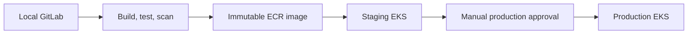

# Code-Keeper GitLab Platform

This repository provisions a local GitLab CE instance and Docker-executor GitLab
Runner inside an Ubuntu 22.04 VirtualBox VM. Vagrant creates the VM; Ansible
installs Docker and configures the GitLab platform.

## Requirements

- VirtualBox
- Vagrant
- Ansible on the laptop
- At least 2 CPU cores, 6 GB RAM, and 30 GB disk available for the VM

Install the Ansible collection before provisioning:

```sh
ansible-galaxy collection install -r ansible/requirements.yml
```

## Initial Deployment

1. Create an encrypted secrets file from the template.

```sh
cp ansible/inventories/vagrant/vault.example.yml ansible/inventories/vagrant/group_vars/gitlab_hosts/vault.yml
ansible-vault encrypt ansible/inventories/vagrant/group_vars/gitlab_hosts/vault.yml
printf '%s' 'your-vault-password' > .vault-password
chmod 600 .vault-password
```

Set `gitlab_initial_root_password_vault` to a password of at least 8
characters. Leave `gitlab_api_token_vault` empty for the first run. This is
the root login password; it is different from the Ansible Vault encryption
password stored in `.vault-password`.

2. Create and provision the VM.

```sh
vagrant up
```

GitLab will be available at `http://192.168.57.10:8929`. The VM uses a VirtualBox
host-only network, so this address works from the laptop regardless of the
network to which the laptop is connected. It is not exposed to other devices.

Alternatively, provision directly after the VM exists:

```sh
ansible-playbook -i ansible/inventories/vagrant/hosts.yml ansible/playbooks/gitlab.yml --ask-vault-pass
```

## Complete The Bootstrap

1. Sign in at GitLab as `root` with `gitlab_initial_root_password_vault`.
2. Create an administrator personal access token with the `api` scope. This is
   the only GitLab token that must be supplied manually.
   - Go to Edit Profile → Access Tokens → Name: `code-keeper-admin`, Scopes: `api`.
3. Add the administrator token to `vault.yml` as `gitlab_api_token_vault` and
   run `vagrant provision` again. This configures policies, creates the group
   and projects, and creates both group runners through the GitLab API.

To edit the vault.yml file, use:

```sh
ansible-vault edit --vault-password-file .vault-password ansible/inventories/vagrant/group_vars/gitlab_hosts/vault.yml
```

The second provision disables public sign-up, enables local password
authentication, applies the password policy, makes defaults private, creates the
`code-keeper` group and its four projects, protects their `main` branches,
creates and registers both Docker runners, and applies their tags and protected
branch settings. It does not create individual users.

## Project Repositories And Runners

The application repositories are sibling Git repositories created from the
provided `crud-master-py` source:

```text
../inventory
../billing
../api-gateway
../cloud-design
```

Set each application repository's Git remote to its private GitLab project:

```sh
git -C ../inventory remote add origin http://192.168.57.10:8929/code-keeper/inventory.git
git -C ../billing remote add origin http://192.168.57.10:8929/code-keeper/billing.git
git -C ../api-gateway remote add origin http://192.168.57.10:8929/code-keeper/api-gateway.git
```

Ansible creates and configures two group runners through the GitLab API:

- `docker-ci`: unprotected, runs build, test, and scan jobs for merge requests.
- `docker-local`: protected, runs ECR publishing and staging/production jobs
  from protected `main` only.

Both runners use the Docker executor. Only the protected runner receives cloud
credentials through protected branches. Runner authentication tokens are
returned by GitLab once during creation and stored only in the VM's runner
configuration files; they are never committed or placed in the vault file.

## Cloud Delivery

`../cloud-design` is the independent AWS infrastructure repository. It defines
separate Terraform state and inputs for staging and production EKS clusters.
Application pipelines use immutable commit-SHA ECR image tags, deploy staging
automatically from `main`, and promote the exact same image after manual
production approval.

Cloud jobs are intentionally disabled until the protected GitLab variable
`CLOUD_DEPLOY_ENABLED=true` and real AWS credentials are configured. This keeps
local CI usable without a cloud account while leaving the audited pipeline
definition complete.



## Required Cloud Variables

The cloud jobs are defined but unavailable until these protected GitLab
variables are supplied. Do not commit their values:

| Variable                                                          | Used by                                                          |
| ----------------------------------------------------------------- | ---------------------------------------------------------------- |
| `AWS_REGION`, AWS deployment identity                             | Infrastructure and application projects                          |
| `TF_STATE_BUCKET`, `TF_SECRET_FILE`                               | Infrastructure project                                           |
| `ECR_REGISTRY`                                                    | Application projects                                             |
| `STAGING_IMAGE_REPOSITORY`, `PRODUCTION_IMAGE_REPOSITORY`         | Each application project                                         |
| `STAGING_EKS_CLUSTER`, `PRODUCTION_EKS_CLUSTER`                   | Application projects                                             |
| `STAGING_KUBERNETES_NAMESPACE`, `PRODUCTION_KUBERNETES_NAMESPACE` | Application projects                                             |
| `CLOUD_DEPLOY_ENABLED`                                            | Infrastructure project, set to `true` only for a real deployment |

## Audit

See `docs/AUDIT_RUNBOOK.md` for repeatable audit commands and the architecture
rationale. Schedule each application pipeline weekly in GitLab in addition to
push and merge-request triggers so `pip-audit` continues to monitor dependency
advisories.

## Operations

```sh
vagrant ssh
sudo docker ps
sudo docker logs gitlab
sudo docker exec gitlab gitlab-rake gitlab:check SANITIZE=true
sudo docker exec gitlab-runner gitlab-runner verify
```

Show the auditable Ansible task list with:

```sh
ansible-playbook -i ansible/inventories/vagrant/hosts.yml ansible/playbooks/gitlab.yml --list-tasks
```

GitLab data persists in `/srv/code-keeper/gitlab` and runner configuration in
`/srv/code-keeper/gitlab-runner` within the VM. Back up these directories before
destroying or recreating the VM.

## Security Notes

- Never commit `vault.yml`, API tokens, runner tokens, or passwords.
- GitLab runs over HTTP only on the private Vagrant network. Do not expose this
  VM to untrusted networks.
- The runner mounts Docker's socket. Trusted projects and protected branches are
  required because CI jobs can control Docker on the VM.
