# Code-Keeper GitLab Platform

This repository provisions a local GitLab CE instance and Docker-executor GitLab
Runner inside an Ubuntu 22.04 VirtualBox VM. Vagrant creates the VM; Ansible
installs Docker and configures the GitLab platform.

## Requirements

The local GitLab platform requires VirtualBox, Vagrant, Ansible, and at least
2 CPU cores, 6 GB RAM, and 30 GB disk for the VM. See
[`ansible/README.md`](ansible/README.md) for provisioning and operations.

## Project Repositories

The application repositories are sibling Git repositories created from the
provided `crud-master-py` source:

```text
../inventory
../billing
../api-gateway
../cloud-design
```

Set each application repository's Git remote to its private GitLab project:

```sh
git remote add origin http://192.168.57.10:8929/code-keeper/inventory.git
git remote add origin http://192.168.57.10:8929/code-keeper/billing.git
git remote add origin http://192.168.57.10:8929/code-keeper/api-gateway.git
```

## Cloud Delivery

`../cloud-design` is the independent AWS infrastructure repository. It defines
separate Terraform state and inputs for staging and production EKS clusters.
Application pipelines use immutable commit-SHA ECR image tags, deploy staging
automatically from `main`, and promote the exact same image after manual
production approval.

Cloud jobs are intentionally disabled until the protected GitLab variable
`CLOUD_DEPLOY_ENABLED=true` and real AWS credentials are configured. This keeps
local CI usable without a cloud account while leaving the audited pipeline
definition complete.

```mermaid
flowchart LR
  GitLab[Code pushed to GitLab]

  subgraph CI[Continuous Integration]
    Build[Build application]
    Test[Run unit and integration tests]
    Scan[Security scan]
    Image[Build Docker image]
    Registry[Push immutable image to ECR]

    Build --> Test --> Scan --> Image --> Registry
  end

  subgraph CD[Continuous Delivery]
    Staging[Deploy image to staging]
    Verify[Validate staging]
    Approval[Manual production approval]
    Production[Deploy same image to production]

    Staging --> Verify --> Approval --> Production
  end

  GitLab --> Build
  Registry --> Staging
```



## Required Cloud Variables

The cloud jobs are defined but unavailable until these protected GitLab
variables are supplied. These variables are set in
the Gitlab project settings:

`Project -> Settings -> CI/CD → Variables -> Add variable`

You can also define shared variables at:

`Group -> Settings -> CI/CD -> Variables -> Add variable`

Group variables are useful for values shared by all application projects.

| Variable                                                                               | Used by                                                                           |
| -------------------------------------------------------------------------------------- | --------------------------------------------------------------------------------- |
| `AWS_REGION`, AWS deployment identity                                                  | Infrastructure and application projects                                           |
| `TF_STATE_BUCKET`, `TF_STAGING_VARS_FILE`, `TF_PRODUCTION_VARS_FILE`, `TF_SECRET_FILE` | Infrastructure project                                                            |
| `ECR_REGISTRY`                                                                         | Application projects                                                              |
| `STAGING_IMAGE_REPOSITORY`, `PRODUCTION_IMAGE_REPOSITORY`                              | Each application project                                                          |
| `STAGING_EKS_CLUSTER`, `PRODUCTION_EKS_CLUSTER`                                        | Infrastructure and application projects                                           |
| `STAGING_KUBERNETES_NAMESPACE`, `PRODUCTION_KUBERNETES_NAMESPACE`                      | Infrastructure and application projects                                           |
| `CLOUD_DEPLOY_ENABLED`                                                                 | Infrastructure and application projects, set to `true` only for a real deployment |

### Cloud Variable Usage

- `build`, `test`, and `scan`: do not require AWS variables.
- Infrastructure `plan` and `apply`: use `AWS_REGION`, `TF_STATE_BUCKET`, `TF_*_VARS_FILE`, and `TF_SECRET_FILE`.
- Infrastructure bootstrap: uses the EKS cluster and Kubernetes namespace variables.
- Application `containerize`: uses AWS credentials, `ECR_REGISTRY`, and the staging image repository.
- Application deployments: use the EKS cluster, namespace, and production image repository variables.
- `CLOUD_DEPLOY_ENABLED=false`: keeps all AWS-dependent jobs disabled.
